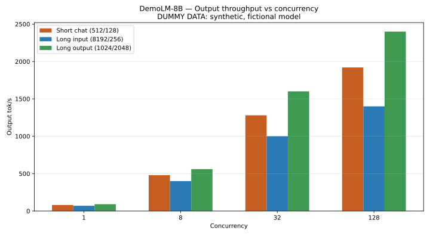
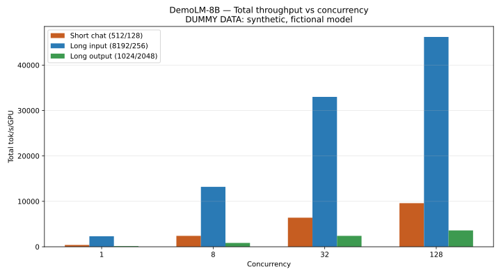
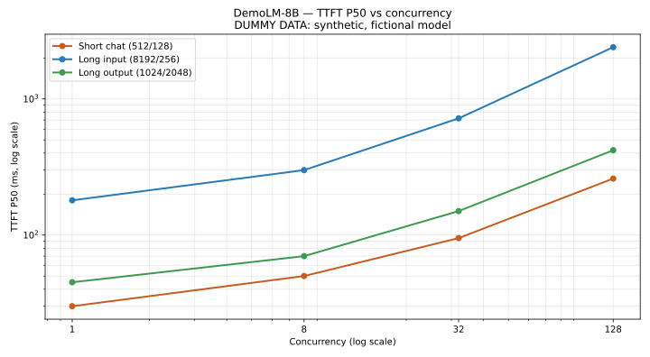
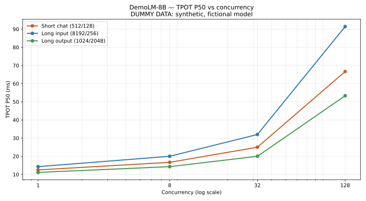

# DemoLM-8B

> **DUMMY DATA — demo fixture only.** Fictional model. Synthetic metrics. Commands have not been executed. Do not download weights or run GPU inference from this page. For documentation and UI validation only.

## Overview

| Hardware | Precision | Parallelism | Workload |
|---|---|---|---|
| 1 x H100 80GB | BF16 | TP = 1 | 3 scenarios / 4 concurrency levels |

Fictional specification: dense 8B parameters, text-only, 32,768-token context, BF16. Model card and license: not applicable (demo fixture). SGLang build: not measured.

## Deployment

<Warning>
**Illustrative only:** this fictional checkpoint does not exist. The command below was not verified and was never executed.
</Warning>

```shell Command
# ILLUSTRATIVE ONLY: this fictional checkpoint does not exist.
sglang serve \
  --model-path /models/demo/DemoLM-8B \
  --served-model-name DemoLM-8B \
  --dtype bfloat16 \
  --tp 1 \
  --context-length 32768 \
  --mem-fraction-static 0.80 \
  --host 127.0.0.1 \
  --port 30000
```

## Benchmark sweep (dummy)

<Warning>
**Dummy only.** Each row is `SCENARIO INPUT_TOKENS OUTPUT_TOKENS`. Not executed.
</Warning>

```shell Command
# DUMMY ONLY: each row is SCENARIO INPUT_TOKENS OUTPUT_TOKENS.
while read -r scenario isl osl; do
  for c in 1 8 32 128; do
    python -m sglang.benchmark.serving \
      --backend sglang --host 127.0.0.1 --port 30000 \
      --model /models/demo/DemoLM-8B --served-model-name DemoLM-8B \
      --dataset-name random --random-input-len "$isl" \
      --random-output-len "$osl" --random-range-ratio 1 \
      --num-prompts 1024 --max-concurrency "$c" \
      --request-rate inf --seed 42
  done
done <<'CASES'
short-chat 512 128
long-input 8192 256
long-output 1024 2048
CASES
```

## Synthetic benchmark results

<Warning>
**All values below are synthetic.** No accuracy result, measured software version, or deployment verification. Random dataset, 1,024 requests/point, request rate = inf, seed = 42, length ratio = 1. Total tok/s/GPU = output tok/s × (input length + output length) / output length / GPU count.
</Warning>

### 1. Short chat — Input 512 / Output 128 tokens

| Concurrency | Total tok/s/GPU | Output tok/s | TTFT P50 (ms) | TPOT P50 (ms) |
|---|---|---|---|---|
| 1 | 400 | 80 | 30 | 12.50 |
| 8 | 2,400 | 480 | 50 | 16.67 |
| 32 | 6,400 | 1,280 | 95 | 25.00 |
| 128 | 9,600 | 1,920 | 260 | 66.67 |

### 2. Long input / document QA — Input 8,192 / Output 256 tokens

| Concurrency | Total tok/s/GPU | Output tok/s | TTFT P50 (ms) | TPOT P50 (ms) |
|---|---|---|---|---|
| 1 | 2,310 | 70 | 180 | 14.29 |
| 8 | 13,200 | 400 | 300 | 20.00 |
| 32 | 33,000 | 1,000 | 720 | 32.00 |
| 128 | 46,200 | 1,400 | 2400 | 91.43 |

### 3. Long output / generation — Input 1,024 / Output 2,048 tokens

| Concurrency | Total tok/s/GPU | Output tok/s | TTFT P50 (ms) | TPOT P50 (ms) |
|---|---|---|---|---|
| 1 | 135 | 90 | 45 | 11.11 |
| 8 | 840 | 560 | 70 | 14.29 |
| 32 | 2,400 | 1,600 | 150 | 20.00 |
| 128 | 3,600 | 2,400 | 420 | 53.33 |

## Performance charts (synthetic)

All charts below are rendered from the synthetic dummy data above.








